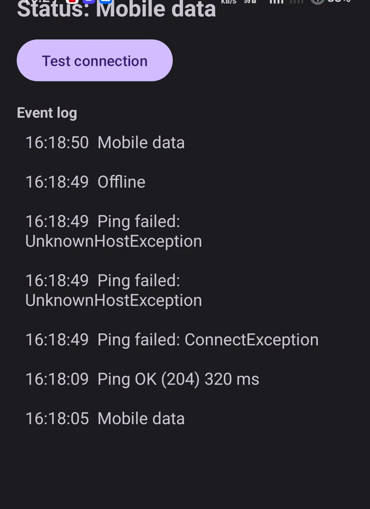

# Network Monitor

A small Android app (Java) that shows the device's current network type in real time, keeps a timestamped log of connectivity changes, and can test internet reachability on demand.

## Features

- Live status: **Wi-Fi**, **Mobile data**, **Ethernet**, or **Offline**
- Timestamped event log (newest first) in a `RecyclerView`
- **Test connection** button that checks internet reachability and shows the response code and latency (for example, `Ping OK (204) 320 ms`)
- Failures are logged with the exception type (for example, `UnknownHostException`)

## Screenshots



## How it works

| Concern | Approach |
|---|---|
| Detecting network changes | `ConnectivityManager.registerDefaultNetworkCallback()` with `onAvailable`, `onCapabilitiesChanged`, and `onLost` |
| Initial offline state | Checked manually with `getActiveNetwork()` in `onStart`, since the callback does not fire when there is no network |
| Lifecycle | Callback registered in `onStart` and unregistered in `onStop` to avoid leaks |
| Threading | Network callbacks arrive on a background thread, so UI updates are posted to the main thread with a `Handler` on `Looper.getMainLooper()` |
| Connection test | `HttpURLConnection` request to `https://www.google.com/generate_204`, run on an `ExecutorService` to keep the main thread free |
| Duplicate events | Repeated identical statuses are skipped so the log stays readable |
| List UI | `RecyclerView` with a custom `LogAdapter` |

## Project structure

```
app/src/main/
├── java/com/example/networkmonitor/
│   ├── MainActivity.java   # network callback, ping test, UI updates
│   └── LogAdapter.java     # RecyclerView adapter for the event log
├── res/layout/
│   ├── activity_main.xml
│   └── item_log.xml
└── AndroidManifest.xml     # ACCESS_NETWORK_STATE, INTERNET
```

## Requirements

- Android Studio (latest stable)
- Min SDK 24
- Language: Java

## Build and run

1. Clone the repository:
   ```
   git clone https://github.com/<your-username>/NetworkMonitor.git
   ```
2. Open the project in Android Studio and let Gradle sync finish.
3. Connect a phone with USB debugging enabled (or start an emulator).
4. Click **Run**.
5. Toggle Wi-Fi, mobile data, or airplane mode and watch the status and log update. Tap **Test connection** to check reachability.

## Possible improvements

- Foreground service so monitoring continues in the background
- MVVM with `ViewModel`, `LiveData`, and a repository class
- Broadcast receiver for airplane mode changes
- Persist the log with Room

## Author

Farhan Hayath